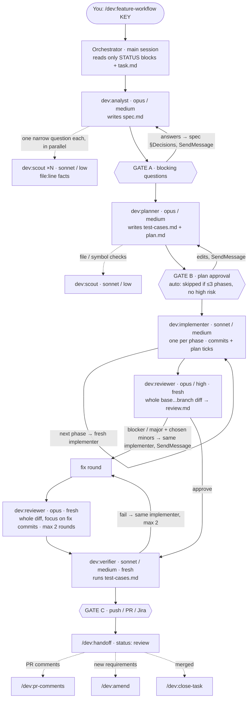

# Design

## Principles
1. **Every session starts from zero.** Files are the only memory, so they are small, current and cheap to read.
2. **Read little at start, the rest on demand.** Session start = project CLAUDE.md + STATUS + task.md + plan up to Next.
3. **Current truth, not history.** Files are rewritten in place. History = git (where used) and decision records.
4. **The "why" is the scarcest knowledge.** Code shows *what*; decisions record *why* and what was rejected.
5. **Work produces knowledge.** Tasks have a lifecycle; at close, what outlives the task is promoted to the project KB.
6. **Isolation by folder.** One project folder = one KB = one context. Personal vault is separate from all projects.
7. **Method ≠ content.** This repo (method) is versioned and shareable; content stays where it belongs.
8. **Pay context only for what can trigger.** Every model-invocable skill description sits in context on every turn. Rare, deliberate skills (setup, upgrade, lint, triage, orchestrators) are `disable-model-invocation: true` — typed, never auto-run, invisible to the model and to agents, so nothing else may depend on invoking them. `dev` is enabled per project folder (`enabledPlugins` in `.claude/settings.local.json`), not globally.
9. **Enforce with config, inform with text.** CLAUDE.md informs; `permissions.deny`, hooks and unconfigured credentials enforce.

## Layers
| Layer | Where | Loaded |
|---|---|---|
| You | `~/.claude/CLAUDE.md` | every session |
| Method | plugins from this repo | skill descriptions always; bodies on use |
| Project map + local rules | `<project>/CLAUDE.md` (not in any repo) | at launch from the project folder |
| Repo conventions | `<repo>/CLAUDE.md` (team) · `CLAUDE.local.md` (you) | when working inside the repo |
| Project knowledge | `<project>/.ai/` | on demand |
| Personal knowledge | vault | via /me:* |

## Three kinds of temporary state
| | Lives in | Lifetime | Created by |
|---|---|---|---|
| Task state | `task.md` Now/Next, `plan.md` ticks, STATUS | until the task closes | `/dev:handoff` |
| Frozen task | `task.md` **Parked** block, WIP commit on branch | weeks/months | `/dev:park` → `/dev:resume` |
| Session thinking | `.ai/stash/*.md` | until restored once | `/kb:stash` → `/kb:unstash` |

## Borrowed ideas
| From | Taken | Not taken |
|---|---|---|
| [Karpathy, LLM Wiki](https://gist.github.com/karpathy/442a6bf555914893e9891c11519de94f) | immutable `raw/` + compiled knowledge with source links; `ingest`, `lint`; good answers filed back | append-only `log.md`; concepts/entities taxonomy; `index.md` catalogs (vault uses `summary` + Bases) |
| [agamarora/second-brain](https://github.com/agamarora/second-brain) | template repo + first-run setup (`init-project`, `init-vault`); private folders out of git; inbox | journal/NOW/TODO/DONE, people pages |
| [kepano, vault](https://stephango.com/vault) | `categories` as links to Base-backed category notes; properties via templates; plural tags; `YYYY-MM-DD`; path-less links | notes in the vault root (we keep one level of domain folders for agent paths and the Drive connector) |
| [Memory Bank](https://tweag.github.io/agentic-coding-handbook/WORKFLOW_MEMORY_BANK) | activeContext/progress → `STATUS.md`; techContext → project CLAUDE.md | reading every file every session; one-repo scope |

What is ours: task lifecycle (spec → plan → implement → verify → close) that feeds the KB; project = multi-repo isolation boundary; capture/triage for side findings; ideas as long-lived files with a status, apart from the inbox; stash and park as distinct temporary states; method separated from content.

## Project knowledge: context and decisions
- **`context/` stays small per file.** Files are rewritten in place, so they only grow: one area per file, ≤300 lines, split by sub-area past that. A grep hit opens the whole file, so a big file costs tokens on every hit.
- **Repo docs win.** `.ai/` is local and outside every repo; a repo's `docs/`/README is versioned with the code and read by the team. What they describe is linked from the Context index, never copied; new knowledge about that code becomes a docs change in the repo. `context/` holds what no repo has: cross-repo flows, domain, data, environments.
- **Decisions are few and never deleted.** Only what outlives the task *and* someone may want to reverse (usually 0–2 per task); task details stay in `spec.md §Decisions` and go to the archive. A replaced decision gets `status: superseded` + `superseded-by: NNNN` in its frontmatter so grep doesn't serve it as a current rule. `/kb:lint` flags contradicting `accepted` records and copies of repo docs.
- **Many repos, one KB — tag, don't nest.** A project with ~10 repos keeps one `tasks/`, `decisions/`, STATUS: tasks and decisions often span repos, and a task's scope can grow into another repo, so a per-repo folder would force a choice, a copy or a move that breaks links. Instead every task (`repos:`), decision (`Repos:`) and STATUS row (Repos column) names its repos. Only `context/` nests (`context/<repo>/`), because knowledge about one repo stays about that repo; the Context index is grouped by repo.
- **Obsidian is an optional viewer, never a dependency.** Every project KB is Obsidian-ready by its normal rules: properties in frontmatter (tasks, decisions, ideas), relative Markdown links (no wikilinks, so grep, GitHub and VS Code read them too), related files linked to each other, links rewritten when a task moves to `archive/`. Opting in at `/dev:init-project` only adds `.ai/views.md` (Bases: tasks by status and repo, archive, decisions, ideas) and a setup checklist; the vault is `.ai/` itself because Obsidian hides dot-folders. Dropping it = deleting `.ai/.obsidian/` and `views.md`. Agents never read `views.md` or need Obsidian.

## Ideas
- **Not inbox items.** Inbox items are short, get triaged and deleted, and age out after 60 days; an idea lives for months, grows with brainstorming and carries `status` (raw → explored → promoted / shelved / dropped) and a verdict. Hence `ideas/`, one file each, never deleted by age.
- **Vault ideas grow into folders.** Once material outgrows the card (research, MVP scope, sketches) the idea becomes `_ideas/<slug>/<slug>.md` + files; on promotion the material moves into the new project's `.ai/`. Project ideas stay one file each (no layout change in projects).
- **An idea lives where it would be implemented.** About a project → `<project>/.ai/ideas/` (client details stay inside the project boundary; promote with `/dev:new-task`). Personal, cross-project or "could become a project" → `Vault/_ideas/`. Skills work on one KB at a time and never mix the two.
- **Only the user's ideas go to `ideas/`.** Improvements Claude notices during other work go to the inbox; triage can move them to `ideas/`.
- **Phone:** `capture` and `brainstorm` fall back to the Google Drive connector when there is no file system, so ideas and inbox items reach the vault from claude.ai; triage and project work happen on the PC.
- No `todo/` (the inbox holds todos that need routing; in the vault a plain todo is a `- [ ]` line in today's daily note, collected by `_tasks.md`) and no `howto/` (vault how-tos are a category filed by topic; project how-tos belong in the repo's docs/README, or in `.ai/context/` only when no repo covers them).

## Personal vault
- **Obsidian is the UI, files are the truth.** Everything an agent needs is in Markdown and frontmatter; Bases only render it. Nothing exists only inside a Base.
- **Two axes.** Folder = what it is about (capitalized domain, one level, fixed list in the vault `CLAUDE.md`); `categories` = what kind of note (Recipes, How-tos, Prompts, Notes). A folder named after a kind (`prompts/`) is the mistake this prevents.
- **Service folders start with `_`** (`_inbox`, `_ideas`, `_daily`, `_raw`, `_categories`, `_templates`, `_attachments`) so Obsidian, Drive and Explorer sort them above the capitalized domains instead of mixing them alphabetically. Project `.ai/` keeps plain names (it has no domains); `/kb:*` skills read `inbox/` etc. as the `_` folder in the vault. New domains and subfolders (past ~50–100 notes) only with the user's OK.
- **No index files.** `summary` in frontmatter is the catalog: Bases show it to the user, grep shows it to agents. Folder note `<Domain>/<Domain>.md` = the domain's Base.
- **Service folders are lowercase** (`inbox`, `ideas`, `daily`, `raw`, `categories`, `templates`, `attachments`) so domains stand out.
- **Obsidian CLI for the link graph only** (`move`, `rename`, `backlinks`, `unresolved`, `base:query`, `tasks`): it needs the app running and is absent in Cowork and claude.ai, so read/write/search stay on plain files and path-less `[[links]]` survive moves without it.
- Templates: the plugin's `templates/note/` is the source, in Obsidian Templates syntax; `/me:init-vault` copies them into the vault's `templates/`.

## Workflows and agents
- **Workflow = orchestrator skill** (`dev:feature-workflow`, `dev:bugfix-workflow`, `dev:spike-workflow`), run in the main session because it needs the user at the gates.
- **Stage = agent** (`playbooks/dev-workflow/agents/`): its own model, effort, tools, maxTurns, color; preloads the matching stage skill (`skills:`) so the procedure has one source of truth.
- **Contract**: every agent returns `STATUS / ARTIFACTS / SUMMARY / QUESTIONS / CAPTURED`; evidence goes into files. The orchestrator never reads transcripts or code.
- **After the PR** the task stays `review` until merged: `dev:amend` (requirements changed — delta spec/plan, never rewrite done work), `dev:pr-comments` (review loop, fixes as a plan phase linked to comments), `dev:close-task` (merged → promote, archive, git cleanup).
- **Gates**: A — blocking questions (never skipped); B — plan/decision approval (skippable with `auto` for small plans); C — anything external: push, PR, Jira, Slack (never skipped).
- **Risk classes, one list for three stages** (`templates/checklists/risk-classes.md`): batch invariants, permission matrix, every consumer of a new field, cache and time zones, placement, reuse, call frequency, error disclosure, concurrency. The analyst turns them into rules and edge cases, the planner answers the applicable ones in `plan.md §Cross-cutting` (shown at GATE B), the reviewer checks them against the diff. One file so the three never drift; born from PR comments the workflow missed.
- **The plan is not the reference for correctness.** The reviewer checks conformance to the plan *and* quality independently; a flaw the plan prescribed is a `plan-level` finding, not an approval.
- **`review.md` = one findings log per task** for every source — reviewer rounds, PR comments, the user. Rows carry an F-ID, risk class, decision and status (open → fixed `hash` → verified / reopened · replied). Nothing is capped or dropped: minor rows go to the user at the review gate. Fix phases name F-IDs, fix-round reviewers verify those rows, replies are drafted from them, and `convention` rows become proposed `<repo>/REVIEW.md` lines.
- Model choice: judgement on `opus` (analyst, planner at medium; reviewer and debugger at high); execution and evidence gathering on `sonnet` (implementer, verifier at medium; researcher at high); code reading delegated to `dev:scout` (`sonnet`/low) so expensive agents keep small contexts — the built-in Explore runs on the caller's model, so it saves nothing. Review fix rounds stay on `opus` and re-read the whole diff, focused on the fix commits — fixes break things through how they interact with the rest. Within a session an agent is continued (SendMessage) for follow-ups on its own work; reviewer and verifier are always fresh. Change in the agent file.
- Worktrees live in `<project>/worktrees/<repo>--<KEY>/`; git-host operations use the per-repo tool recorded in the project CLAUDE.md.
- Plugin agents ignore `hooks`, `mcpServers`, `permissionMode` — those come from the session/project.
- Orchestrators stay in `skills/` next to stage skills: a plugin's `workflows/` folder is reserved by Claude Code for JS workflows, and the folder doesn't change the slash name anyway.

### Feature workflow — agent map

Solid arrows: stage order. Dotted: scouts (cheap reading) and what follows the PR. `SendMessage` = the same agent continues in this session; everything else starts fresh and learns from the task files. Gates are you.

## Testing
- **Design before code**: the planner writes `test-cases.md` from the AC (one+ case per AC, negatives, edge cases, unaffected users), choosing the lowest level that proves the behaviour: unit → integration → e2e → manual. Existing repo frameworks only, unless the user agrees otherwise.
- **Automate**: the implementer's test steps name the TC IDs they automate and fill `Automated by`. Bugs start as `TC-01` = the failing test from the debugger.
- **Execute independently**: the verifier runs automated cases, executes what it can itself (API, read-only DB, CLI), proposes missing cases; UI/human-only cases stay `⏳ for QA` with exact steps and data.
- **Persist**: results go into `test-cases.md` (Status + Runs history), which doubles as the manual-QA handoff; reusable cases are promoted to `.ai/qa/regression.md` when the task closes.

## Versioning of project-side structure
Method updates itself (plugins). What lives in projects is versioned by `.ai/.playbook.json` `schema`, changed only by migrations in `playbooks/dev-workflow/migrations/`, applied by `/dev:upgrade-project`. The KB rules in each project CLAUDE.md sit in a managed block (`agent-playbook:kb` markers) that upgrades replace; everything outside it belongs to the project.

## Prompts and tools
- No `prompts/` folder. A reusable prompt is a skill (procedure) or a CLAUDE.md line (rule).
- Scripts a skill needs live in that skill's folder (`scripts/`).
- Subagents ship in a playbook's `agents/` (e.g. `playbooks/dev-workflow/agents/verifier.md`).
- MCP servers are per machine and per project (`claude mcp add --scope local`) — never in this repo, because they carry credentials and environment specifics.
