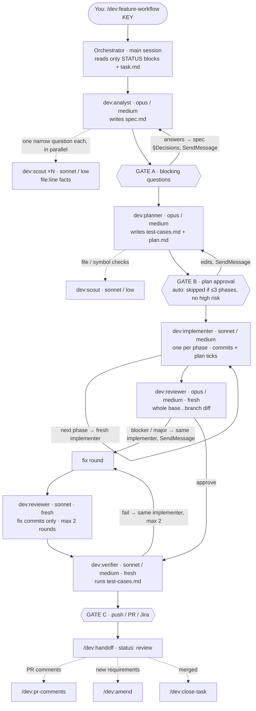

# Design

## Principles
1. **Every session starts from zero.** Files are the only memory, so they are small, current and cheap to read.
2. **Read little at start, the rest on demand.** Session start = project CLAUDE.md + STATUS + task.md + plan up to Next.
3. **Current truth, not history.** Files are rewritten in place. History = git (where used) and decision records.
4. **The "why" is the scarcest knowledge.** Code shows *what*; decisions record *why* and what was rejected.
5. **Work produces knowledge.** Tasks have a lifecycle; at close, what outlives the task is promoted to the project KB.
6. **Isolation by folder.** One project folder = one KB = one context. Personal vault is separate from all projects.
7. **Method ≠ content.** This repo (method) is versioned and shareable; content stays where it belongs.
8. **Enforce with config, inform with text.** CLAUDE.md informs; `permissions.deny`, hooks and unconfigured credentials enforce.

## Layers
| Layer | Where | Loaded |
|---|---|---|
| You | `~/.claude/CLAUDE.md` | every session |
| Method | plugins from this repo | skill descriptions always; bodies on use |
| Project map + local rules | `<project>/CLAUDE.md` (not in any repo) | at launch from the project folder |
| Repo conventions | `<repo>/CLAUDE.md` (team) · `CLAUDE.local.md` (you) | when working inside the repo |
| Project knowledge | `<project>/.ai/` | on demand |
| Personal knowledge | vault | via /me:* |

## Three kinds of temporary state
| | Lives in | Lifetime | Created by |
|---|---|---|---|
| Task state | `task.md` Now/Next, `plan.md` ticks, STATUS | until the task closes | `/dev:handoff` |
| Frozen task | `task.md` **Parked** block, WIP commit on branch | weeks/months | `/dev:park` → `/dev:resume` |
| Session thinking | `.ai/stash/*.md` | until restored once | `/kb:stash` → `/kb:unstash` |

## Borrowed ideas
| From | Taken | Not taken |
|---|---|---|
| [Karpathy, LLM Wiki](https://gist.github.com/karpathy/442a6bf555914893e9891c11519de94f) | immutable `raw/` + compiled knowledge with source links; `ingest`, `lint`; good answers filed back; `index.md` (vault) | append-only `log.md`; concepts/entities taxonomy |
| [agamarora/second-brain](https://github.com/agamarora/second-brain) | template repo + first-run setup (`init-project`, `init-vault`); private folders out of git; inbox | journal/NOW/TODO/DONE, people pages |
| [Memory Bank](https://tweag.github.io/agentic-coding-handbook/WORKFLOW_MEMORY_BANK) | activeContext/progress → `STATUS.md`; techContext → project CLAUDE.md | reading every file every session; one-repo scope |

What is ours: task lifecycle (spec → plan → implement → verify → close) that feeds the KB; project = multi-repo isolation boundary; capture/triage for side findings; stash and park as distinct temporary states; method separated from content.

## Workflows and agents
- **Workflow = orchestrator skill** (`dev:feature-workflow`, `dev:bugfix-workflow`, `dev:spike-workflow`), run in the main session because it needs the user at the gates.
- **Stage = agent** (`playbooks/dev/agents/`): its own model, effort, tools, maxTurns, color; preloads the matching stage skill (`skills:`) so the procedure has one source of truth.
- **Contract**: every agent returns `STATUS / ARTIFACTS / SUMMARY / QUESTIONS / CAPTURED`; evidence goes into files. The orchestrator never reads transcripts or code.
- **After the PR** the task stays `review` until merged: `dev:amend` (requirements changed — delta spec/plan, never rewrite done work), `dev:pr-comments` (review loop, fixes as a plan phase linked to comments), `dev:close-task` (merged → promote, archive, git cleanup).
- **Gates**: A — blocking questions (never skipped); B — plan/decision approval (skippable with `auto` for small plans); C — anything external: push, PR, Jira, Slack (never skipped).
- Model choice: judgement on `opus` (analyst, planner, reviewer at medium; debugger at high); execution and evidence gathering on `sonnet` (implementer, verifier at medium; researcher at high); code reading delegated to `dev:scout` (`sonnet`/low) so expensive agents keep small contexts — the built-in Explore runs on the caller's model, so it saves nothing. Review fix rounds re-review only the fix commits on `sonnet`. Within a session an agent is continued (SendMessage) for follow-ups on its own work; reviewer and verifier are always fresh. Change in the agent file.
- Worktrees live in `<project>/worktrees/<repo>--<KEY>/`; git-host operations use the per-repo tool recorded in the project CLAUDE.md.
- Plugin agents ignore `hooks`, `mcpServers`, `permissionMode` — those come from the session/project.
- Orchestrators stay in `skills/` next to stage skills: a plugin's `workflows/` folder is reserved by Claude Code for JS workflows, and the folder doesn't change the slash name anyway.

### Feature workflow — agent map

Solid arrows: stage order. Dotted: scouts (cheap reading) and what follows the PR. `SendMessage` = the same agent continues in this session; everything else starts fresh and learns from the task files. Gates are you.

## Testing
- **Design before code**: the planner writes `test-cases.md` from the AC (one+ case per AC, negatives, edge cases, unaffected users), choosing the lowest level that proves the behaviour: unit → integration → e2e → manual. Existing repo frameworks only, unless the user agrees otherwise.
- **Automate**: the implementer's test steps name the TC IDs they automate and fill `Automated by`. Bugs start as `TC-01` = the failing test from the debugger.
- **Execute independently**: the verifier runs automated cases, executes what it can itself (API, read-only DB, CLI), proposes missing cases; UI/human-only cases stay `⏳ for QA` with exact steps and data.
- **Persist**: results go into `test-cases.md` (Status + Runs history), which doubles as the manual-QA handoff; reusable cases are promoted to `.ai/qa/regression.md` when the task closes.

## Versioning of project-side structure
Method updates itself (plugins). What lives in projects is versioned by `.ai/.playbook.json` `schema`, changed only by migrations in `playbooks/dev/migrations/`, applied by `/dev:upgrade-project`. The KB rules in each project CLAUDE.md sit in a managed block (`agent-playbook:kb` markers) that upgrades replace; everything outside it belongs to the project.

## Prompts and tools
- No `prompts/` folder. A reusable prompt is a skill (procedure) or a CLAUDE.md line (rule).
- Scripts a skill needs live in that skill's folder (`scripts/`).
- Subagents ship in a playbook's `agents/` (e.g. `dev/agents/verifier.md`).
- MCP servers are per machine and per project (`claude mcp add --scope local`) — never in this repo, because they carry credentials and environment specifics.
